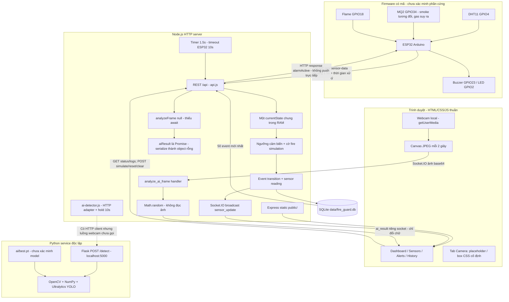
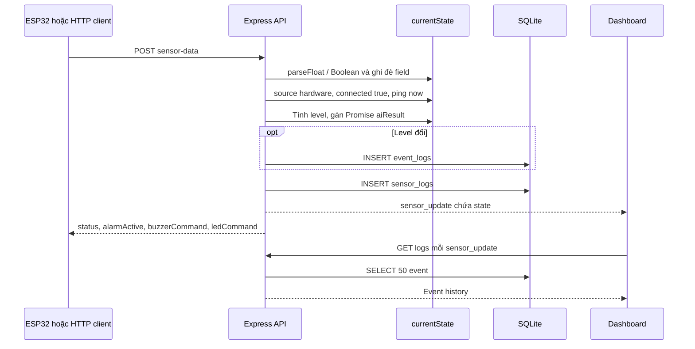
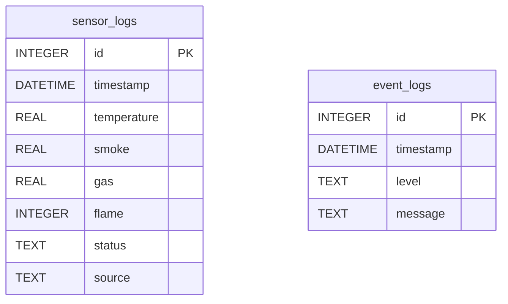
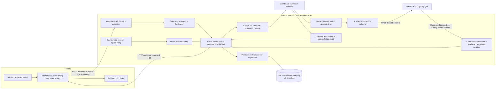

# Kiến trúc Smart Fire Guard

Ngày: 18/10/2026. Sơ đồ hiện trạng phản ánh working tree đã đọc; kết nối hardware/inference chưa được thử end-to-end. Mũi tên liền biểu diễn đường gọi có trong mã, không hàm ý đã vận hành trên phần cứng. Mũi tên nét đứt chỉ liên kết bị thiếu/lỗi hoặc đề xuất, theo nhãn.

## 1. Kiến trúc hiện tại

Phát hiện cốt lõi: không có đường thông suốt `webcam → adapter → Python → alarm`. API sensor gọi adapter với null và không await; handler ảnh lại dùng mock riêng. Trọng số tồn tại không chứng minh AI đang phục vụ dashboard. `ai_result` không cập nhật state, không ghi detection và không kích hoạt còi ESP32.

Luồng nguồn dữ liệu cũng chưa cách ly: một state chung cho simulation và hardware. Khi offline, timer thay telemetry bằng số giả; sau restart state trở về mặc định thay vì phục hồi/đánh dấu unknown. Đây là kiến trúc prototype local/LAN, chưa có bằng chứng hạ tầng cloud.

## 2. Trình tự nhận telemetry hiện tại

Các await SQLite cho phép request khác thay state trước khi luồng cũ hoàn tất. Cần snapshot immutable cho từng lần xử lý và cơ chế tuần tự hóa transition. Firmware chỉ dùng `alarmActive`; các chuỗi `RED_BLINK/YELLOW_ON/GREEN_ON` chưa có driver màu tương ứng.

## 3. Mô hình dữ liệu hiện có

Hai bảng chưa có quan hệ FK. Schema không lưu độ tin cậy AI, class/box, device/camera, timestamp thiết bị, sensor health hoặc acknowledgment của lệnh. `getSensorHistory` chưa được expose. Timestamp format hiện phụ thuộc timezone máy chủ; đề xuất giữ UTC ở storage và format theo timezone cấu hình ở UI.

## 4. Kiến trúc nâng cấp đề xuất, chưa triển khai

Giữ Node.js/CommonJS, Express, Socket.IO, SQLite, HTML/CSS/JS, Flask/Ultralytics và ESP32/Arduino. Đây là phân tách trách nhiệm trong stack hiện có, không phải đề xuất chuyển framework, database hoặc thêm MQTT/microservices mới.

Định hướng thiết kế [đề xuất]:

- `LIVE`, `DEMO`, `OFFLINE/STALE` có ý nghĩa rõ; demo không phát command tới hardware. Không lấy simulation làm bằng chứng môi trường an toàn khi mất thiết bị.
- Sensor alarm và AI evidence độc lập. AI unavailable không có nghĩa không cháy; negative AI không được xóa danger từ cảm biến. Luật fusion và hysteresis phải được ghi thành bảng và kiểm thử.
- Mỗi inference gắn camera ID, frame ID và thời gian; bỏ kết quả cũ, giới hạn số frame đang chờ. Giữ cảnh báo 10s theo camera, tách `confidence` số khỏi cờ `held`.
- Operator acknowledge/silence không sửa số đo. Reset chỉ reset demo hoặc điều kiện latch theo policy đã công bố.
- Giai đoạn đầu vẫn có thể một thiết bị/một camera để giảm phạm vi, nhưng phải khai báo giới hạn. Đa thiết bị là mở rộng sau khi luồng chính ổn định.
- Không lưu ảnh webcam mặc định; bổ sung indicator đang gửi ảnh, bật/tắt và dừng stream/timer khi không sử dụng. Chỉ lưu metadata detection cần cho đánh giá, nếu lưu ảnh phải có mục đích và lựa chọn rõ ràng.
- Migration đề xuất thêm device/time/health cho sensor, nguyên nhân và liên kết event, bảng detection và audit/command khi triển khai tính năng tương ứng; giữ dữ liệu cũ, backup và thử migration trên bản sao trước.

## 5. Ranh giới tin cậy và vận hành

Hiện trạng: Node mở REST/Socket cho client tiếp cận mạng, CORS `*`, không identity; Python mặc định bind loopback khi chạy trực tiếp; frontend và firmware dùng HTTP, không có TLS trong repo. Không có dấu hiệu Node public static expose thư mục `data/` hoặc `ai/` vì static root là `public/`.

Đề xuất: device token khác operator session/token; chỉ operator được simulate/reset/xóa log; kiểm tra socket handshake và quyền cho từng event; origin allowlist và giới hạn JSON/frame/request. Giữ Python loopback trong triển khai cùng máy; không expose inference port nếu chưa có lý do. Với browser webcam qua LAN, triển khai secure context phù hợp yêu cầu [getUserMedia](https://developer.mozilla.org/en-US/docs/Web/API/MediaDevices/getUserMedia).

Theo dõi riêng `serverConnected`, `deviceLastSeen`, `sensorHealth`, `aiReady`, `lastInferenceAt`, `dbReady`, độ trễ và lỗi. Readiness chỉ xanh khi dependency bắt buộc đã sẵn sàng; mất AI không được đổi sensor danger thành ok. Shutdown cần dừng timer, đóng socket/server và SQLite. Cổng tự đổi chỉ phù hợp demo; hardware dùng URL cố định nên vận hành cần cấu hình port rõ và báo lỗi dễ hiểu.

Ưu tiên giữ lại: threshold engine có thể tách thành hàm thuần, hợp đồng REST/Socket đang dùng, SQLite helpers có parameter binding, firmware HTTP payload, dashboard responsive và Web Audio. Cần test baseline trước khi refactor, xem [DEVELOPMENT_PLAN.md](DEVELOPMENT_PLAN.md).
