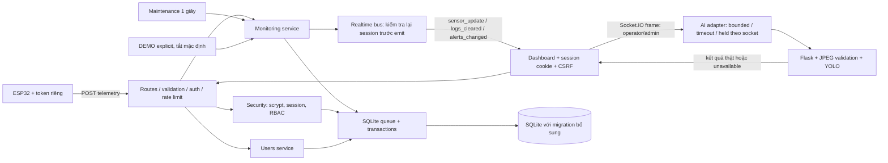
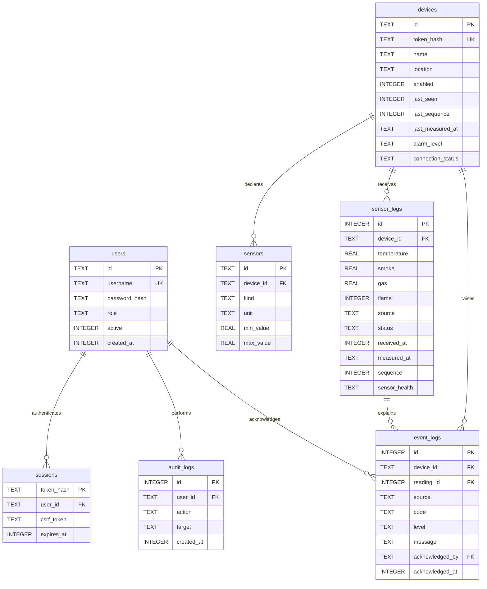

# Backend architecture — Smart Fire Guard

> Phần AI đã được đánh giá tiếp tại [AI_ASSESSMENT.md](AI_ASSESSMENT.md): checkpoint chưa validated, mặc định không load nếu chưa pin trust hash, thêm frame identity/freshness và fallback giữ luật cảm biến độc lập. Tài liệu này giữ snapshot kiến trúc backend; không xem model score là xác suất cháy.

Ngày nâng cấp: 18/10/2026. Tài liệu này mô tả implementation mới; các PROJECT_ANALYSIS/ARCHITECTURE/FRONTEND_UPGRADE trước đó là snapshot trước nâng cấp backend.

## 1. Phân tích trước thay đổi và quyết định

Đã đọc lại `server.js`, toàn bộ `src/`, firmware, Python service, frontend và tests trước sửa. API cũ có sáu routes: telemetry, status, logs, simulate, reset, clear. Tất cả dùng một mutable state, chưa identity/validation/auth; auto-simulation trộn vào live, reset sửa số đo, route gọi async AI thiếu await, handler ảnh lại random. Lịch sử cũ có giá trị nên được giữ nguyên.

Giữ CommonJS, Express, Socket.IO và SQLite, frontend thuần, Arduino và Flask/Ultralytics. Manifest được đồng bộ với lockfile và thư viện đã có: Express 5.2.1, sqlite3 6.0.1, Socket.IO 4.8.4, cors 2.8.6; không cài package Node mới. Node tối thiểu 22.16 để dùng native env loader/fetch/test runner. CORS được xử lý bằng allowlist trong app/Socket.IO; dependency cors cũ chưa bị gỡ để tránh thay đổi lock tree ngoài phạm vi.

Kiến trúc trước triển khai đã được trình bày trong hội thoại. Đây là modular monolith, một process Node và một SQLite connection có queue; không thêm message broker, ORM hay dịch vụ xác thực bên ngoài.

Ảnh webcam đã đi qua Python adapter, không còn random trong server chạy thật. Kết quả AI chỉ trả về camera client; **chưa fusion vào alarm thiết bị, chưa có bảng lưu AI detection**. Đây là giới hạn rõ ràng, tránh biến một camera không định danh thành bằng chứng điều khiển mọi ESP32.

## 2. Ranh giới module

| File | Trách nhiệm |
|---|---|
| `server.js` | Load `.env`, startup/listen fail-fast, tín hiệu shutdown; không chứa nghiệp vụ |
| `src/app.js` | Factory có dependency injection, HTTP headers/origin/body limit, middleware lỗi, Socket.IO và lifecycle |
| `src/config.js` | Parse/ràng buộc config; production bắt buộc HTTPS origins và Secure cookie |
| `src/errors.js` | AppError, error codes và async route wrapper |
| `src/validation.js` | Strict allowlist field, kiểu/range/timestamp/sequence, pagination và threshold schema |
| `src/security.js` | Password hashing/verify, opaque sessions, CSRF, role guard, device auth, bounded rate limiter |
| `src/routes/api.js` | Mapping request → validator/guard/service → response; không chứa state cảm biến |
| `src/services/monitoring.js` | Thiết bị, telemetry, trạng thái nguồn/freshness, transition, lịch sử, threshold và DEMO |
| `src/services/users.js` | Tạo/cập nhật người dùng, giữ admin cuối, thu hồi sessions và audit |
| `src/database.js` | SQLite Promise wrapper, hàng đợi read/write, transaction, migration idempotent |
| `src/ai-detector.js` | HTTP AI timeout/status/schema, unknown khi lỗi, hold/release theo camera socket |

## 3. Thiết kế dữ liệu

`settings(key,value)` lưu threshold JSON đã validation. `sensors` là metadata cấu hình, UNIQUE(device_id,kind); bốn field telemetry vẫn là một snapshot rộng trong `sensor_logs` để bảo toàn schema/API cũ và cùng thời điểm đọc. Chưa hỗ trợ tùy ý thêm loại cảm biến bằng API.

Migration schema v1 tạo bảng mới, `ALTER TABLE ADD COLUMN` cho hai bảng cũ, tạo index `(device_id,id DESC)` và unique `(device_id,sequence)` khi sequence không null. FK được bật. Các hàng cũ không có device_id/received_at vẫn giữ nguyên và được history API trả về; không tự gán nguồn/device không có bằng chứng.

Queue tuần tự hóa cả read lẫn write trên cùng connection; write dùng `BEGIN IMMEDIATE/COMMIT/ROLLBACK`. Một request lỗi không làm hỏng queue tiếp theo. Không dùng mutable RAM làm nguồn telemetry: trạng thái dựng lại từ database nên restart phục hồi số đo/threshold/session. DEMO chỉ là state tách trong RAM, restart kết thúc DEMO.

Timestamp bản ghi mới là UTC; `received_at` là epoch ms phía server, `measured_at` là ISO có timezone. API trả timestamp raw, không format theo timezone máy chủ. Index phục vụ history theo device; chưa có retention tự xóa dữ liệu.

**Chuyển đổi dữ liệu:** runtime chạy migration khi khởi động. Lượt nâng cấp này chỉ chạy migration trên database tạm trong test, không chạy server trên `data/fire_guard.db` hiện tại. Sao lưu trước lần chạy mới đầu tiên bằng `scripts/backup-db.py`; SQLite backup API lấy cả WAL đã commit, không copy file DB đang hoạt động một cách rời rạc.

## 4. Bảo mật và phân quyền

- Mật khẩu 12–128 ký tự; scrypt với salt 16 byte ngẫu nhiên, N=16384/r=8/p=1; verify bằng timingSafeEqual. Không có mật khẩu mặc định. Bootstrap tạo admin đầu tiên từ env, không reset mật khẩu tài khoản cũ. Server từ chối khởi động nếu không có active admin và không cấu hình bootstrap.
- Session token random 32 byte, chỉ SHA-256 hash lưu trong DB; cookie HttpOnly, SameSite=Strict, Path=/, Secure ở production. CSRF token riêng bắt buộc với mọi mutation bằng session. Frontend giữ CSRF trong memory, không lưu password/session token vào localStorage.
- Device token random 32 byte, database chỉ hash; token trả một lần khi create/rotate, không có trong list/status/logs. Token device không có quyền operator; session người dùng không gửi telemetry thay device token được.
- Role viewer đọc dữ liệu, operator nhận diện ảnh/DEMO/reset-DEMO/acknowledge, admin quản lý device/user/threshold/xóa log. Không thể vô hiệu hóa/demote active admin cuối cùng.
- Origin allowlist cho HTTP và Socket.IO, không dùng `*`. Không tin X-Forwarded-For mặc định. CSRF và role được kiểm tra phía server, việc ẩn nút frontend chỉ phục vụ UX.
- HTTP JSON body tối đa 16KiB, socket payload 512KiB, frame string 450.000 ký tự; một frame mỗi 2s/socket, một inference đang chạy/socket. Engine.IO tối đa 100 connections/process. Python chỉ nhận JPEG tối đa 2048x2048, kiểm tra header trước decode và chỉ một inference tại một thời điểm.
- Rate limiter theo IP cho API/login, theo device đã xác thực cho telemetry; cửa sổ và bộ nhớ có giới hạn. Login mặc định 10 request/15 phút/IP, API 600/phút/IP, telemetry 120/phút/device.
- Security headers/CSP, no-store API, request IDs, JSON errors không trả stack/SQL internals. Audit không chứa mật khẩu/token hoặc body nhạy cảm.
- Socket kiểm tra session ở Engine.IO handshake, Socket.IO middleware, mỗi frame và trước mỗi broadcast; timer thu hồi subscribers hết hạn/disabled. Logout/user update disconnect socket liên quan.

Các lựa chọn được đối chiếu với [Express security](https://expressjs.com/en/advanced/best-practice-security/), [Node crypto](https://nodejs.org/api/crypto.html) và [Socket.IO middleware](https://socket.io/docs/v4/middlewares/). Bảo vệ cookie không thay thế TLS: LAN/production cần HTTPS ở reverse proxy và thiết bị cần kênh truyền bảo mật phù hợp. Firmware vẫn dùng HTTPClient với URL mẫu HTTP cho LAN, chưa có provisioning TLS/certificate.

## 5. Telemetry, freshness và lệnh thiết bị

- Bắt buộc đủ temperature/smoke/gas/flame; không parseFloat chuỗi. Temperature −40..125°C, smoke/gas 0..100% tương đối. Flame chỉ boolean hoặc số 0/1; `"false"` bị reject.
- `health.<kind>=fault` yêu cầu giá trị kind tương ứng null. Fault không thành 0 hoặc 30°C. Nếu có bằng chứng DANGER từ sensor khác vẫn ưu tiên bad; nếu không, fault làm level unknown.
- `deviceId` nếu gửi phải trùng token. Nếu có `measuredAt`, timestamp phải có timezone, không quá clock skew tương lai, không cũ đến max age và không lùi so với mẫu trước. Max-age không được lớn hơn stale threshold.
- `sequence` là tùy chọn để tương thích firmware; khi gửi phải tăng, giá trị trùng/đảo thứ tự trả 409. Client cần giữ counter qua reboot. **Không thể phát hiện replay cũ nếu firmware bỏ cả sequence và timestamp**; khi thiếu measuredAt hệ thống dùng thời điểm nhận. Không tuyên bố có chống replay hoàn chỉnh cho client legacy.
- Transaction lưu reading, transition/fault/online event và device state. Chỉ sau commit mới phát Socket.IO. Command response được chụp theo reading của đúng device, không lấy state tổng hoặc DEMO.
- Bình thường/warn trả OFF; bad trả ON; unknown trả `alarmActive:null`, `buzzerCommand:HOLD`, giữ đầu ra cũ. Không giả định mất dữ liệu là an toàn.
- Maintenance mỗi giây: online → stale sau 10s → offline sau 30s mặc định; event chỉ khi connection phase thay đổi. Không sửa telemetry hoặc thêm sensor rows trên heartbeat. Snapshot stale có level unknown, giữ lastKnownLevel/số đo cuối và source hardware; không tự chuyển DEMO.
- Tổng quan ưu tiên device có bad, sau đó warn, unknown, ok; endpoint status?deviceId xem riêng. Payload realtime chứa cả danh sách thiết bị. DEMO chỉ hiển thị khi operator chủ động bật và config cho phép; lệnh thiết bị luôn tính riêng từ live reading.

## 6. Giới hạn triển khai và kiểm chứng

Đây là thiết kế cho một installation, một Node process, SQLite local. Không có tenant ACL, distributed rate limits, HA/cluster, password recovery/2FA, registry cảm biến tùy ý, retention, device certificate provisioning hay AI fusion. Rate limiting trong RAM reset khi process restart. Tăng quy mô cần thiết kế riêng, không giả vờ đã hỗ trợ.

Firmware đã thêm header token, file secrets riêng, DHT fault null và giữ output khi response unknown. Chưa compile/nạp/chạy ESP32 thật; vòng đọc/còi còn phụ thuộc mạng như baseline, chưa có local fail-safe hoàn chỉnh. Không coi backend upgrade là chứng nhận hệ thống báo cháy.

Kết quả test, cách chạy và contract cụ thể tại [BACKEND_API.md](BACKEND_API.md). Python test dùng model stub; không nạp `best.pt`, không đo precision/recall hoặc kiểm tra camera/âm thanh/browser layout trong lượt này.
